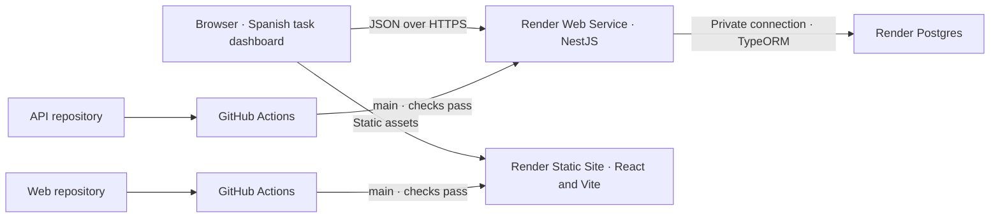
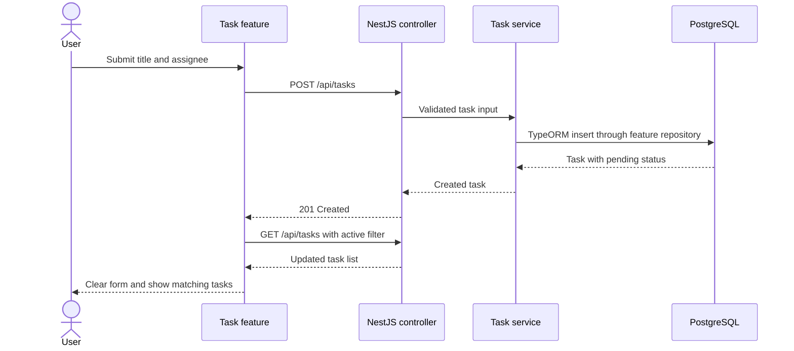

# Task manager architecture

## System layout

The frontend and API have independent Git histories and build outputs. Docker Compose joins the two repositories and starts the same three service roles on a developer machine. A named volume preserves the local database.

## Request lifecycle

The NestJS controller validates input and maps application outcomes to HTTP responses. The service coordinates task behavior and the feature repository uses TypeORM. A task entity maps PostgreSQL columns. Schema changes use explicit TypeORM migrations with synchronization disabled. Pagination and counts run in a repeatable-read transaction. The health endpoint verifies database connectivity.

Axios centralizes the base URL, request timeout, and transport error classification. The task feature owns form, list, filter, pagination, and mutation state. Reads are cancellable and tied to the active filter and page. PostgreSQL applies filtering, ordering, and pagination, and the frontend renders the returned items and total. Browser storage holds only the selected filter.

TanStack Query uses `['tasks', statusFilter, page, pageSize]` as the cache key with a 30-second stale time. Creates invalidate task queries. A status change updates the saved row in the current cache when it still matches the view. If its filter membership changes, invalidation fetches the authoritative page and total. Other cached views become stale. Automatic mutation retries are disabled.

## Routes and failures

The React app has one screen at `/`. Its stateful filter and page controls do not need client-side routing. NestJS decorators map `/api/tasks`, `/api/tasks/:id/status`, and `/health`. Swagger UI at `/docs` and OpenAPI JSON at `/docs-json` describe the public contract.

NestJS returns 400 for invalid input, 404 for missing tasks, 409 for stale task versions, and a generic 500 for unexpected failures. Status changes atomically compare the supplied version and increment it on success. The health endpoint returns 503 when PostgreSQL is unavailable. The frontend also recognizes 429 from an upstream service and asks the user to retry later. Required-field errors stay beside the inputs, and failed writes retain the draft. Timeout, network, and response errors pass through one Axios interceptor.

## Interface

The dashboard places the form beside the task list on wide screens and stacks them on narrow screens. The list includes status text alongside color. The filter and row status use labeled controls. Shared inputs display feature-specific validation, and the API validates independently. Failed writes retain drafts and failed reads provide a retry. A shared notification provider shows dismissible success messages, with inline feedback available as a fallback. Keyboard focus and reduced-motion behavior are handled globally.

## Verification boundaries

Unit tests isolate storage and backend logic. HTTP integration tests use a dedicated PostgreSQL database. Web integration tests exercise the rendered application with MSW at the network boundary. Playwright uses the Docker stack in desktop and mobile viewports. GitHub Actions runs these checks automatically, and Render tracks passing checks on the production branch.
