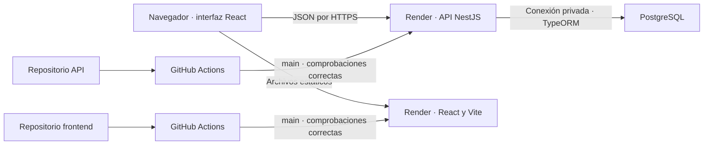
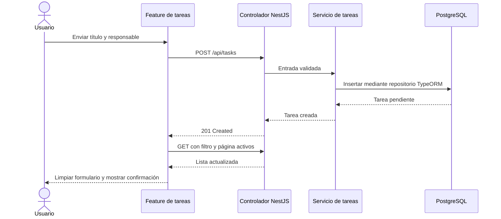

# Arquitectura del gestor de tareas

## Distribución del sistema

Frontend y API tienen historial y compilación independientes. Docker Compose reúne ambos repositorios y PostgreSQL localmente. Un volumen conserva la base. Los despliegues independientes requieren contratos compatibles; no constituyen una publicación atómica.

## Ciclo de una petición

El controlador valida y traduce resultados a HTTP; el servicio representa operaciones y el repositorio concentra persistencia. La entidad mapea columnas. Las migraciones son explícitas y `synchronize` está desactivado. Elementos y total se leen en una transacción de lectura repetible. La salud verifica conexión a PostgreSQL.

## Límites del frontend

La feature contiene reglas, API tipada, componentes y `useTasks`. Los campos, paginación y notificaciones viven en `shared`. Los proveedores globales y transporte quedan fuera de la feature. Los componentes React son funciones; no se introducen clases para duplicar el modelo de NestJS.

Axios comparte origen, timeout y normalización de errores. React Hook Form controla campos y envío. TanStack Query controla datos remotos. PostgreSQL aplica filtros, orden y paginación. El almacenamiento del navegador conserva únicamente el filtro.

## Caché y escritura

La clave es `['tasks', statusFilter, page, pageSize]`, con 30 segundos de vigencia. Crear invalida consultas. Un cambio de estado usa la fila guardada para actualizar la vista si aún coincide con el filtro. Si cambia su pertenencia, se vuelve a consultar página y total. Otras vistas quedan invalidadas. Las lecturas son cancelables y no se reintentan escrituras automáticamente.

La versión enviada por el cliente se compara e incrementa atómicamente en SQL. Una versión antigua recibe `409`, sin sobrescribir el cambio de otro cliente. El frontend refresca y ofrece reintento deliberado. No existe actualización entre navegadores en tiempo real.

## Rutas, validación y errores

La única pantalla React está en `/`; no se necesita enrutador. NestJS expone el contrato en `/api/tasks`, `/api/tasks/:id/status` y `/health`. Swagger está en `/docs` y su JSON en `/docs-json`.

NestJS devuelve `400` para entrada inválida, `404` para tarea inexistente, `409` para versión antigua y `500` genérico para fallos inesperados. Salud devuelve `503` sin base disponible. El frontend también reconoce `429` de un intermediario; no hay limitador de peticiones implementado. Red y timeout pasan por el interceptor compartido. La validación de formulario mejora la experiencia y no sustituye la del servidor.

## Interfaz y notificaciones

En escritorio se muestran formulario y lista en columnas alineadas; en móvil se apilan. Estados y errores tienen texto, controles etiquetados y foco visible. Una escritura fallida conserva el borrador y una lectura fallida ofrece reintento. El proveedor genérico encola notificaciones de éxito con cierre manual o automático; sin proveedor existe confirmación en línea. Los errores de escritura permanecen visibles en la vista.

## Configuración y límites

Cada repositorio incluye `.env.example`. Vite carga su configuración pública durante la compilación. La API recibe variables del proceso; en ejecución nativa se usa `node --env-file=.env`, mientras Docker y Render las inyectan. Credenciales reales y archivos de entorno quedan fuera de Git.

Las pruebas unitarias aíslan reglas y colaboradores. La integración HTTP utiliza PostgreSQL dedicado. Testing Library y MSW comprueban interfaz en el límite de red. Playwright recorre Docker en escritorio, tablet y móvil, complementado con capturas e inspección visual. GitHub Actions ejecuta comprobaciones y Render sigue las aprobadas de producción. No se afirma auditoría completa de accesibilidad, seguridad ni carga.
